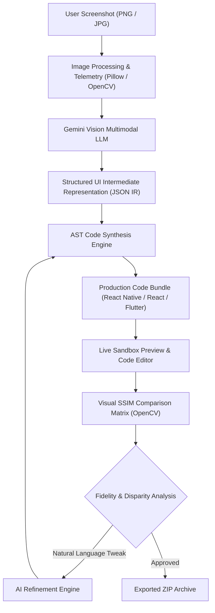
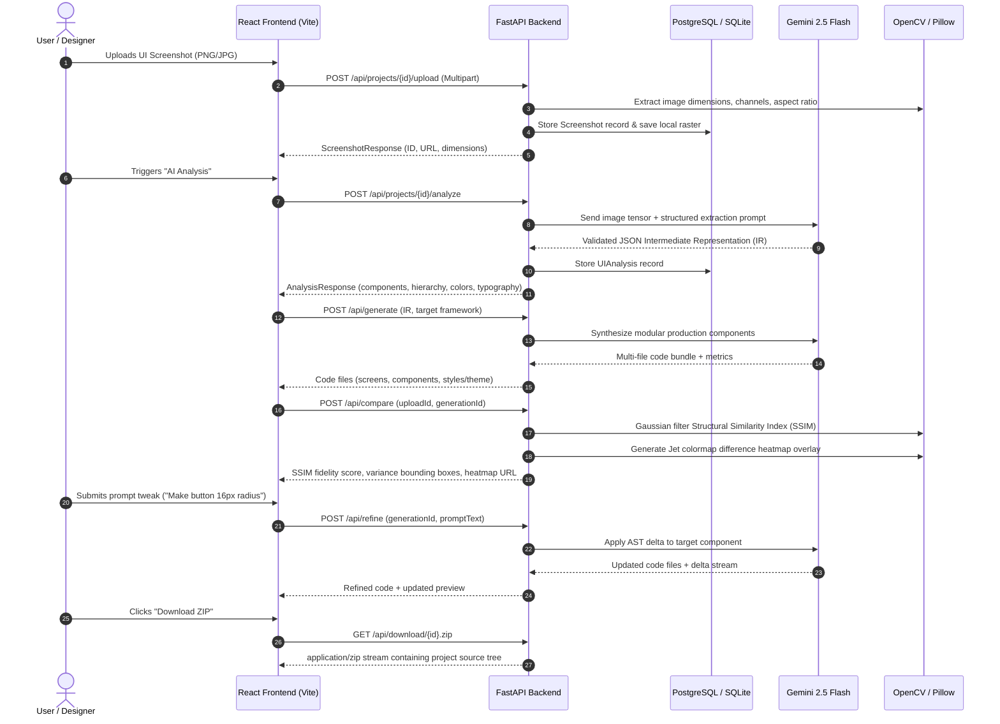

# UIForge AI — System Architecture & Pipeline Specification

## 1. System Overview

UIForge AI bridges the gap between visual raster designs (screenshots, mockups, PNG/JPG assets) and production frontend code by executing a structured multi-stage synthesis pipeline:



---

## 2. End-to-End Workflow Sequence

The interaction flow across the client, API gateway, multimodal AI model, image processing modules, and persistent storage:



---

## 3. UI Intermediate Representation (JSON IR)

Before synthesizing code for any target platform, UIForge AI normalizes the analyzed visual tree into a structured, technology-agnostic **UI Intermediate Representation (IR)**.

### IR Schema

```json
{
  "screenName": "LoginScreen",
  "layoutType": "flex-column",
  "dimensions": {
    "width": 390,
    "height": 844
  },
  "colorPalette": {
    "primary": "#2563EB",
    "secondary": "#10B981",
    "background": "#0F172A",
    "textPrimary": "#FFFFFF",
    "textSecondary": "#94A3B8"
  },
  "typography": {
    "fontFamily": "Inter",
    "baseFontSize": 16
  },
  "components": [
    {
      "id": "comp_header",
      "type": "navbar",
      "label": "Navigation Header",
      "bounding_box": {
        "x": 5.0,
        "y": 4.0,
        "width": 90.0,
        "height": 6.0
      },
      "style": {
        "textColor": "#94A3B8",
        "fontSize": 14
      }
    },
    {
      "id": "comp_submit_btn",
      "type": "button",
      "label": "Sign In to Workspace",
      "bounding_box": {
        "x": 8.0,
        "y": 60.0,
        "width": 84.0,
        "height": 7.5
      },
      "style": {
        "backgroundColor": "#0284C7",
        "textColor": "#FFFFFF",
        "borderRadius": 12
      }
    }
  ]
}
```

### Key Design Tenet: Normalized Percentage Coordinates
* `bounding_box.x`, `y`, `width`, and `height` are normalized as floating-point percentages ($0.0\%\text{--}100.0\%$).
* This prevents hardcoded pixel lock-in and allows the code generator to map responsive flexbox / grid rules that scale seamlessly across device screen sizes.

---

## 4. Visual Comparison Matrix (OpenCV SSIM)

To evaluate the precision of the generated UI against the original source design:

1. **Resolution Normalization**:
   Both source and rendered images are scaled to identical dimensions using `cv2.resize` with Lanczos interpolation.
2. **Grayscale SSIM Calculation**:
   Calculated using a $11 \times 11$ Gaussian kernel ($\sigma = 1.5$):
   $$\text{SSIM}(x, y) = \frac{(2\mu_x\mu_y + C_1)(2\sigma_{xy} + C_2)}{(\mu_x^2 + \mu_y^2 + C_1)(\sigma_x^2 + \sigma_y^2 + C_2)}$$
3. **Jet Diff Heatmap**:
   `cv2.absdiff` computes pixel-level absolute difference. A `cv2.COLORMAP_JET` overlay is generated and blended at $40\%$ opacity over the original mockup to visually highlight layout, spacing, and color variances.
