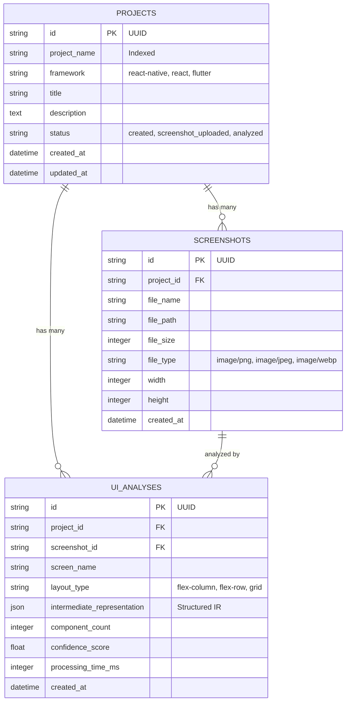

# UIForge AI — Database Schema Specification

## 1. Overview & Dual Dialect Strategy

UIForge AI uses **SQLAlchemy ORM** to manage data persistence. It supports:
* **Production**: PostgreSQL 15+ (using `psycopg2-binary`).
* **Local Development & Testing**: SQLite 3 (`uiforge.db` or `:memory:`).

The database layer features a 1-second auto-probe that falls back to local SQLite if PostgreSQL is unreachable, allowing local development and testing to run without a local PostgreSQL daemon.

---

## 2. Entity-Relationship (ER) Diagram

---

## 3. Detailed Table Definitions

### 3.1. `projects` Table
Tracks user projects, selected target frontend framework, and workflow progression.

| Column | Type | Constraints | Description |
| :--- | :--- | :--- | :--- |
| `id` | `VARCHAR(36)` | `PRIMARY KEY` | Project UUID (`uuid4().hex`) |
| `project_name` | `VARCHAR(255)` | `NOT NULL`, `INDEX` | Human-readable project identifier |
| `framework` | `VARCHAR(50)` | `NOT NULL`, `DEFAULT 'react-native'` | Target frontend framework |
| `title` | `VARCHAR(255)` | `NULLABLE` | Display title |
| `description` | `TEXT` | `NULLABLE` | User description or notes |
| `status` | `VARCHAR(50)` | `NOT NULL`, `DEFAULT 'created'` | Workflow lifecycle state |
| `created_at` | `TIMESTAMP WITH TIME ZONE` | `DEFAULT NOW()` | Record creation timestamp |
| `updated_at` | `TIMESTAMP WITH TIME ZONE` | `ON UPDATE NOW()` | Last update timestamp |

#### Project Lifecycle States (`status`):
* `created` &mdash; Initialized via project setup.
* `screenshot_uploaded` &mdash; Screenshot successfully stored and validated.
* `analyzed` &mdash; Intermediate Representation extracted and stored.

---

### 3.2. `screenshots` Table
Stores uploaded UI screenshots, metadata, and pixel dimensions.

| Column | Type | Constraints | Description |
| :--- | :--- | :--- | :--- |
| `id` | `VARCHAR(36)` | `PRIMARY KEY` | Screenshot UUID |
| `project_id` | `VARCHAR(36)` | `FOREIGN KEY (projects.id)`, `NOT NULL` | Associated project |
| `file_name` | `VARCHAR(255)` | `NOT NULL` | Original client filename |
| `file_path` | `VARCHAR(500)` | `NOT NULL` | Server filesystem path |
| `file_size` | `INTEGER` | `NOT NULL` | Size in bytes |
| `file_type` | `VARCHAR(50)` | `NOT NULL` | MIME type (`image/png`, etc.) |
| `width` | `INTEGER` | `NULLABLE` | Pixel width (via Pillow) |
| `height` | `INTEGER` | `NULLABLE` | Pixel height (via Pillow) |
| `created_at` | `TIMESTAMP WITH TIME ZONE` | `DEFAULT NOW()` | Upload timestamp |

---

### 3.3. `ui_analyses` Table
Stores AI vision analysis outputs and the complete JSON Intermediate Representation.

| Column | Type | Constraints | Description |
| :--- | :--- | :--- | :--- |
| `id` | `VARCHAR(36)` | `PRIMARY KEY` | Analysis UUID |
| `project_id` | `VARCHAR(36)` | `FOREIGN KEY (projects.id)`, `NOT NULL` | Associated project |
| `screenshot_id` | `VARCHAR(36)` | `FOREIGN KEY (screenshots.id)`, `NULLABLE` | Associated screenshot |
| `screen_name` | `VARCHAR(255)` | `NOT NULL` | Detected screen identifier |
| `layout_type` | `VARCHAR(50)` | `NOT NULL` | Dominant layout flow |
| `intermediate_representation` | `JSON` / `TEXT` | `NOT NULL` | Full structured JSON IR |
| `component_count` | `INTEGER` | `NOT NULL` | Total detected UI components |
| `confidence_score` | `FLOAT` | `NOT NULL` | Model confidence ($0\text{--}100\%$) |
| `processing_time_ms` | `INTEGER` | `NOT NULL` | Inference & parsing latency |
| `created_at` | `TIMESTAMP WITH TIME ZONE` | `DEFAULT NOW()` | Analysis timestamp |
