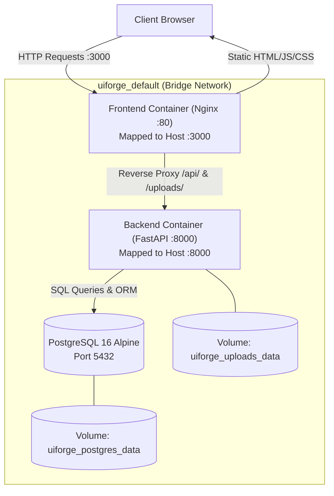

# Docker Deployment & Containerization Guide

UIForge-AI includes production-grade containerization with multi-stage builds, reverse-proxy routing, and container orchestration via Docker Compose.

---

## 1. Container Topology



---

## 2. Service Specifications

| Service | Base Image | Internal Port | Host Port | Purpose |
| :--- | :--- | :--- | :--- | :--- |
| **`frontend`** | `node:20-alpine` (builder) $\rightarrow$ `nginx:alpine` (runtime) | `80` | `3000` | Multi-stage production build; serves SPA and proxies `/api/` & `/uploads/` to backend. |
| **`backend`** | `python:3.11-slim` | `8000` | `8000` | FastAPI application with OpenCV (`libgl1`, `libglib2.0-0`), Pillow, Google GenAI SDK, and SQLAlchemy. |
| **`db`** | `postgres:16-alpine` | `5432` | `5432` | Relational storage for projects, screenshots, structured UI analysis IR, and generations. |

---

## 3. Quickstart: Running with Docker

### Prerequisites
- [Docker Desktop](https://www.docker.com/products/docker-desktop/) or Docker Engine $\ge 24.0$ with Docker Compose v2.

### Step 1: Provide Gemini API Key
Create a `.env` file in the root directory (or export the variable in your terminal):
```bash
GEMINI_API_KEY=your_gemini_api_key_here
```

### Step 2: Build and Start Containers
```bash
# Build images and launch services in detached mode
docker compose up -d --build
```

### Step 3: Access the Application
- **UIForge Studio Frontend**: [http://localhost:3000](http://localhost:3000)
- **FastAPI Interactive Docs**: [http://localhost:8000/docs](http://localhost:8000/docs)
- **PostgreSQL Connection**: `localhost:5432` (User: `postgres`, Pass: `uiforge_password`, DB: `uiforge_db`)

---

## 4. Operational Commands

### View Service Logs
```bash
# Stream logs for all services
docker compose logs -f

# Stream backend logs specifically
docker compose logs -f backend
```

### Stop Containers
```bash
# Stop containers without removing persistent data
docker compose down

# Stop containers and erase database & upload volumes
docker compose down -v
```

### Rebuild After Changes
```bash
docker compose up -d --build
```

---

## 5. Storage Persistence

Two named Docker volumes persist all data across container restarts and updates:
- **`uiforge_postgres_data`**: Stores PostgreSQL database tables, relational records, and execution states.
- **`uiforge_uploads_data`**: Stores uploaded screenshot images, cropped bounding boxes, and OpenCV SSIM visual heatmaps.
